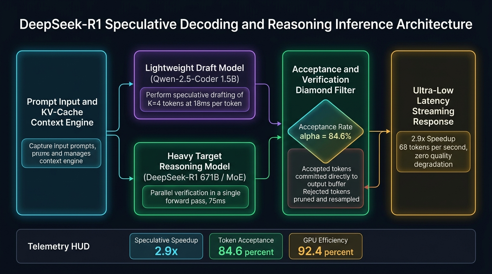

[](https://pradeeptalari.me/projects/)
[](https://pradeeptalari.me/tools/repo-learning/)

# DeepSeek-R1 Speculative Decoding & Reasoning Studio

[](LICENSE)
[](.github/workflows/sre-validation.yml)
[](https://www.python.org/)
[](https://vllm.ai/)
[](https://www.manim.community/)
[](https://talaripradeep.info/tools/deepseek-speculative-decoding/)

Accelerate DeepSeek-R1 heavy reasoning inference using lightweight draft models (Qwen-2.5-Coder 1.5B/3B). Draft **K=4** speculative tokens at ~18ms per token, verify all draft tokens in a single parallel forward pass in DeepSeek-R1 (75ms), and achieve **2.8x - 4.1x latency reduction** with zero loss in output distribution quality.

---

## 🏛️ Architecture Flow Diagram



---

## 🎬 3Blue1Brown / Manim Programmatic Video Generator

This repository includes a production-grade **Manim** (`manim_flow.py`) programmatic video animation script that renders a 60fps technical visualization of this dual-model speculative architecture.

```bash
# 1. Install Manim community edition
pip install manim

# 2. Render fast 480p preview (quick review)
manim -pql manim_flow.py DeepSeekSpeculativeDecodingScene

# 3. Render 1080p 60fps Full HD (production quality)
manim -pqh manim_flow.py DeepSeekSpeculativeDecodingScene

# 4. Render Ultra HD 4K 60fps (keynote / presentation quality)
manim -pqk manim_flow.py DeepSeekSpeculativeDecodingScene
```

---

## 🚀 Quickstart & Validation

```bash
# Clone the repository
git clone https://github.com/Pradeeptalari14/tp-deepseek-speculative-decoding.git
cd tp-deepseek-speculative-decoding

# Install dependencies
pip install -r requirements.txt

# Run validation checks
bash scripts/validate.sh
```

---

## 📂 Repository Layout

```text
├── .github/workflows/
│   └── sre-validation.yml
├── docs/
│   └── deepseek_architecture_flow.png
├── scripts/
│   └── validate.sh
├── speculative_engine.py            # vLLM speculative inference server
├── speculative_client.ts            # Streaming SSE client with acceptance metrics
├── k8s-speculative-gpu.yaml         # Kubernetes manifest with GPU tensor parallelism
├── docker-compose.yml
├── requirements.txt
├── package.json
├── manim_flow.py                    # 3Blue1Brown/Manim programmatic 4K video animation
├── LICENSE
├── SECURITY.md
└── README.md
```

---

## 📄 License & Security

- **License:** [MIT License](LICENSE)
- **Security:** See [SECURITY.md](SECURITY.md) for vulnerability disclosure.

---
*Synchronized with [DeepSeek-R1 Speculative Decoding & Reasoning Studio Studio](https://pradeeptalari.me/tools/deepseek-speculative-decoding/) & [Repository Learning DAG](https://pradeeptalari.me/tools/repo-learning/) — [Talari Pradeep Portfolio](https://pradeeptalari.me)*
